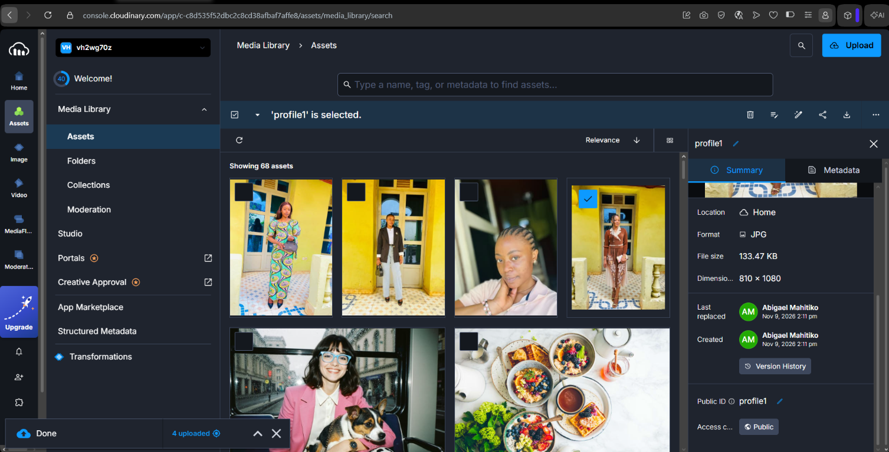

# Galerie photo Cloudinary — Abigael Mahitiko

## Présentation du projet

J’ai réalisé **ABIGAEL MAHITIKO**, une galerie photo qui répond au devoir de Cloud Computing. Mon objectif était de créer un site personnel, agréable à parcourir sur ordinateur et sur téléphone, et d’utiliser Cloudinary pour héberger et diffuser mes images.

Les quatre portraits présentés sur le site proviennent de mon espace Cloudinary. Je les affiche à partir de leurs URL publiques, sans enregistrer les fichiers image dans le projet. Les photos sont cliquables : un clic ouvre une fiche détaillée avec une description, l’adresse Cloudinary à copier, ainsi que des options pour partager et télécharger le portrait.

## Aperçu de mon espace Cloudinary

Voici une capture de ma bibliothèque Cloudinary, où j’ai téléversé les images utilisées par la galerie :



Les identifiants publics des quatre portraits utilisés sur le site sont `profile3`, `profile2`, `profile4` et `profile1`.

## Fonctionnalités

- **Une présentation personnalisée** : page d’accueil, identité visuelle et présentation de la galerie.
- **Quatre portraits Cloudinary** : chaque image possède un titre, un texte descriptif et une catégorie.
- **Des filtres** : j’organise les images par portraits, style et instants.
- **Un affichage détaillé** : je peux ouvrir une image en grand format, lire sa description et passer au portrait précédent ou suivant.
- **Une URL à copier** : la fiche affiche l’adresse publique Cloudinary de l’image, avec un bouton de copie et une solution de repli si le navigateur n’autorise pas le presse-papiers.
- **Le partage** : le site utilise le partage natif du navigateur lorsqu’il est disponible ; sinon, il propose de copier l’adresse de l’image.
- **Le téléchargement** : le lien de téléchargement demande à Cloudinary de transmettre le fichier comme pièce jointe.
- **Une navigation mobile** : un menu hamburger s’ouvre sur petit écran et les images, la galerie et leurs fiches s’adaptent à la largeur du téléphone.
- **L’accessibilité** : les photos et les actions sont utilisables au clavier, et les images ont des textes alternatifs.

## Technologies utilisées

- **HTML5** pour structurer les pages, les portraits et leurs informations.
- **CSS3** pour la mise en page, les couleurs, la typographie, les animations et l’adaptation aux différentes tailles d’écran.
- **JavaScript natif** pour les filtres, le menu mobile, l’ouverture des fiches, la navigation entre portraits, la copie des URL et le partage.
- **Cloudinary** pour stocker, transformer et diffuser les images.
- **GitHub** pour héberger le code source et, après activation de GitHub Pages, publier le site.

Le projet ne dépend d’aucun framework ni d’aucun paquet à installer.

## Comment j’utilise Cloudinary

J’ai téléversé mes images dans ma bibliothèque Cloudinary, puis j’ai utilisé leur **identifiant public** dans les URL de la galerie. Le navigateur demande ainsi chaque image directement au CDN Cloudinary ; les photos ne sont pas copiées dans le dépôt GitHub.

Par exemple, l’adresse d’origine du portrait `profile3` est :

```text
https://res.cloudinary.com/vh2wg70z/image/upload/profile3.jpg
```

Dans la galerie, je demande aussi une version optimisée adaptée à l’affichage. Une URL contient notamment les paramètres `f_auto`, `q_auto` et `w_900` : Cloudinary peut choisir un format adapté au navigateur, optimiser la qualité et limiter la largeur délivrée à la taille nécessaire.

Pour télécharger le fichier au lieu de l’afficher, j’ajoute le paramètre de livraison `fl_attachment` au chemin Cloudinary. Pour partager un portrait ou copier son adresse, le site fournit son URL publique d’origine.

### Identifiants et URL des portraits

| Ordre | Nom affiché | Identifiant public | URL Cloudinary |
|---|---|---|---|
| 1 | Couleurs en lumière | `profile3` | [Ouvrir l’image](https://res.cloudinary.com/vh2wg70z/image/upload/profile3.jpg) |
| 2 | Élégance du quotidien | `profile2` | [Ouvrir l’image](https://res.cloudinary.com/vh2wg70z/image/upload/profile2.jpg) |
| 3 | Un instant pour soi | `profile4` | [Ouvrir l’image](https://res.cloudinary.com/vh2wg70z/image/upload/profile4.jpg) |
| 4 | La douceur des tons chauds | `profile1` | [Ouvrir l’image](https://res.cloudinary.com/vh2wg70z/image/upload/profile1.jpg) |

### Sécurité et droits

Les images de la galerie sont diffusées avec leurs URL publiques, comme demandé pour les afficher sur un site web. Je ne publie **aucune clé secrète ni API secret Cloudinary** dans le code ou dans le dépôt. J’utilise uniquement des images que je suis autorisée à publier. Avant de mettre ce projet en ligne, je vérifie que les paramètres de livraison des ressources permettent leur affichage aux visiteurs.

## Lancer le projet sur mon ordinateur

Je peux ouvrir directement `index.html` dans un navigateur. Pour tester la galerie depuis un serveur local, j’ouvre un terminal dans le dossier du projet et j’exécute :

```bash
python -m http.server 8000
```

Sous Windows, je peux aussi utiliser `py -m http.server 8000`. J’ouvre ensuite [http://localhost:8000](http://localhost:8000) dans mon navigateur. Le serveur local n’est utile que pour mes essais ; il n’y a ni dépendances ni étape de compilation.

## Publier le projet sur GitHub et avec GitHub Pages

Pour préparer le dépôt GitHub, je peux exécuter ces commandes depuis le dossier du projet après avoir créé un dépôt vide sur GitHub :

```bash
git init
git add index.html styles.css script.js README.md assets/cloudinary-media-library.png
git commit -m "Créer la galerie Cloudinary d'Abigael Mahitiko"
git branch -M main
git remote add origin https://github.com/VOTRE-NOM/VOTRE-DEPOT.git
git push -u origin main
```

Je remplace `VOTRE-NOM` et `VOTRE-DEPOT` par les informations de mon dépôt. Je ne place jamais de secret Cloudinary dans les commandes, les fichiers ou l’historique Git.

Pour publier gratuitement la galerie avec GitHub Pages, j’ouvre ensuite les paramètres de mon dépôt GitHub, puis **Settings → Pages**. Dans la rubrique de déploiement depuis une branche, je choisis la branche `main` et le dossier `/ (root)`, puis j’enregistre. GitHub Pages publie les fichiers statiques du projet. Après la fin du déploiement, je peux récupérer l’adresse du site dans cette même rubrique.

**Lien du site publié :** à compléter après l’activation de GitHub Pages.

```text
https://VOTRE-NOM.github.io/VOTRE-DEPOT/
```

Je remplace cette adresse d’exemple par le lien communiqué par GitHub et je mets le README à jour avant de remettre ou de partager le projet.

## Organisation des fichiers

```text
ABI CLOUDINARY/
├── index.html                         # Structure et contenu de la galerie
├── styles.css                         # Présentation et adaptation mobile
├── script.js                          # Filtres, menu, fiches et actions photo
├── README.md                          # Présentation et instructions du projet
└── assets/
    └── cloudinary-media-library.png   # Capture de la bibliothèque Cloudinary
```

## Résultat

J’ai créé une galerie personnelle, responsive et interactive à partir de quatre portraits téléversés sur Cloudinary. Le site affiche des descriptions, utilise les URL publiques et permet d’agrandir, de copier, de partager et de télécharger les images. Il est prêt à être envoyé sur GitHub ; le lien public sera disponible après la publication du dépôt avec GitHub Pages.
